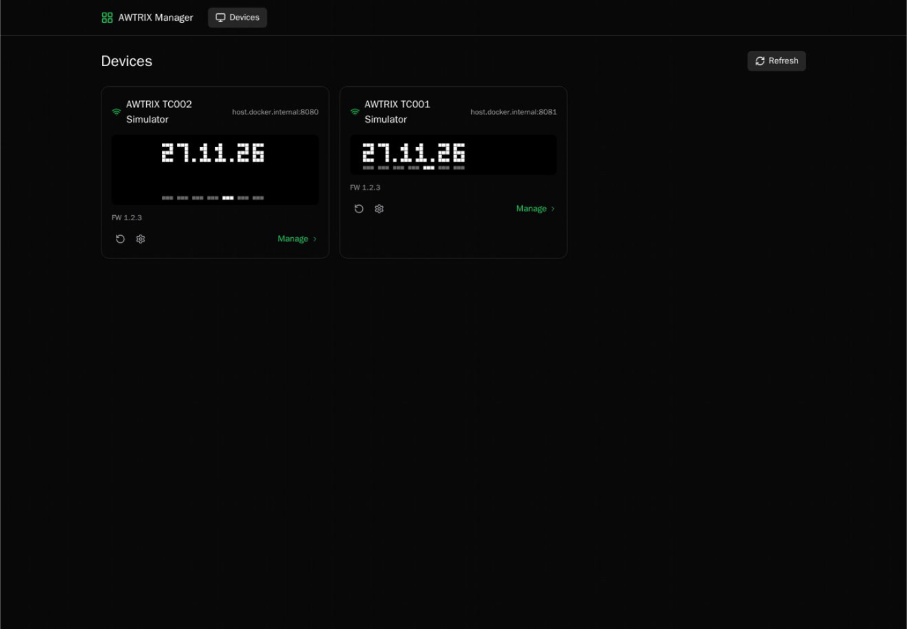
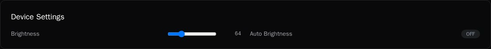

# Home Assistant Add-on: AWTRIX Manager

Manage AWTRIX NG LED matrix displays from Home Assistant. The add-on provides a
single interface for configured displays and their installed apps, Berry scripts,
device settings, files, and backups.

## Screenshots

The examples below use simulator devices and contain no real device or network
configuration.





## Features

- Monitor multiple configured displays and their current status.
- View, reorder, enable, and disable apps already installed on a display.
- Edit and deploy Berry scripts with the built-in editor.
- Adjust display settings and manage device files.
- Export and restore device backups.
- Open the interface through Home Assistant Ingress.

## Installation

Add this repository to Home Assistant and install **AWTRIX Manager** from the
add-on store:

[](https://my.home-assistant.io/redirect/supervisor_add_addon_repository/?repository_url=https%3A%2F%2Fgithub.com%2Fadrianoamalfi%2Fhassos-addons)

## Configuration

Configure the display hostname or address under **Settings → Add-ons → AWTRIX
Manager → Configuration**. For example:

```yaml
devices:
  - host: "awtrix-simulator.local"
    name: "AWTRIX Simulator"
```

Use an address reachable from the add-on container. See [full documentation](DOCS.md)
for configuration options and data storage details.

## Support and contributions

Report problems through the [repository issue tracker](https://github.com/adrianoamalfi/hassos-addons/issues/new/choose).
See the repository [contributor guide](../CONTRIBUTING.md) for development and
release conventions.

## Project relationship and licensing

AWTRIX Manager is an independent Home Assistant add-on that communicates with
AWTRIX NG devices through their API. It is not affiliated with or endorsed by
the AWTRIX NG project. The name AWTRIX NG is used only to identify the devices
this add-on supports.

The add-on's original code is distributed under the repository's
[Apache License 2.0](../LICENSE). AWTRIX NG firmware is a separate project with
its own [PolyForm Noncommercial License 1.0.0](https://github.com/Blueforcer/awtrix-ng/blob/main/LICENSE.md).
That firmware is not included in this add-on; users are responsible for
following the firmware's terms when obtaining or using it. This add-on does not
grant rights to AWTRIX NG firmware, its assets, or other third-party works.

The current dependency inventory and licensing status are documented in
[THIRD-PARTY-NOTICES.md](THIRD-PARTY-NOTICES.md).
