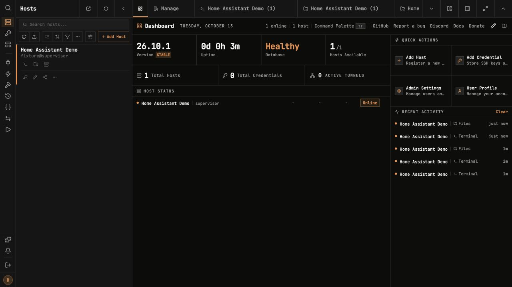
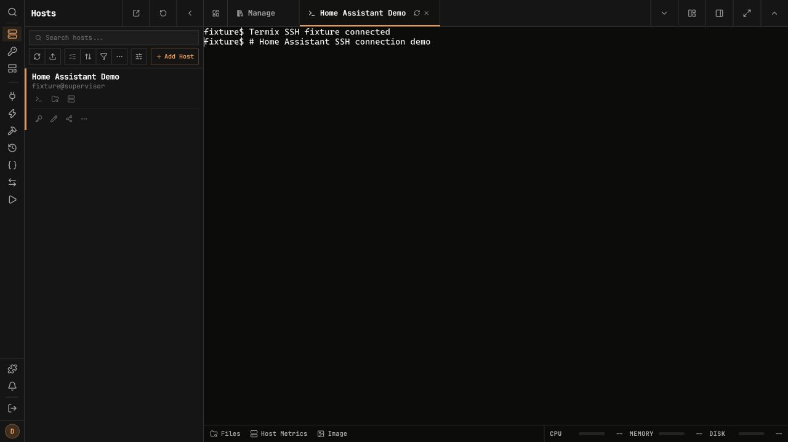
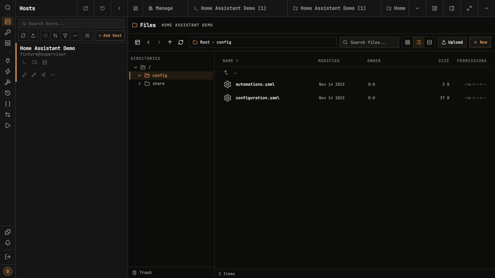

# Termix for Home Assistant

Independent integration of [Termix](https://github.com/Termix-SSH/Termix) for Home
Assistant. Maintains Termix's official visual identity; no upstream endorsement is implied.

Manage SSH hosts, open interactive terminals and transfer files from Home Assistant.
Supports amd64 and aarch64. This app is experimental until its complete ingress and
backup flow has been verified on HAOS.

Install Termix from this repository and open its panel. Create a Termix account,
then install the SSH and file management plugins through Termix.

Termix authentication remains enabled. Home Assistant controls access to the panel;
Termix accounts control access to hosts and credentials. No LAN port is published.

The optional OPKSSH binary is not bundled: its Go dependency
`github.com/yeqown/reedsolomon@v1.0.0` has no license in the distributed source tag.
OPKSSH requires a separately obtained upstream binary. Ordinary SSH key and
password authentication and SFTP do not require OPKSSH.

See [configuration and backup instructions](DOCS.md).

## Screenshots

Captured from Termix 26.10.1 through the local ingress test fixture. Hosts,
credentials and files are synthetic; these are not screenshots of a private HA installation.

Use the [Home Assistant connection guide](HOME_ASSISTANT.md) for Terminal & SSH
and Advanced SSH & Web Terminal, including key authentication and read-only snippets.

Upstream: [Termix](https://github.com/Termix-SSH/Termix), Apache License 2.0.
Copyright 2026 Luke Gustafson. See [LICENSE](LICENSE) and [attributions and modifications](NOTICE).
See [licensing review and remaining release checks](LICENSE_REVIEW.md).
